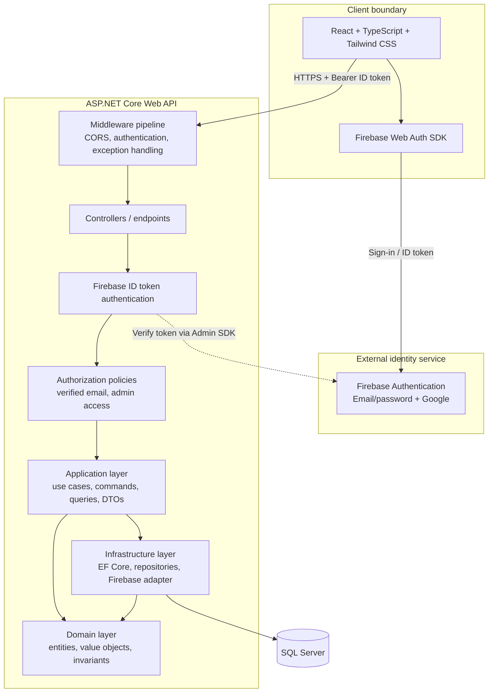
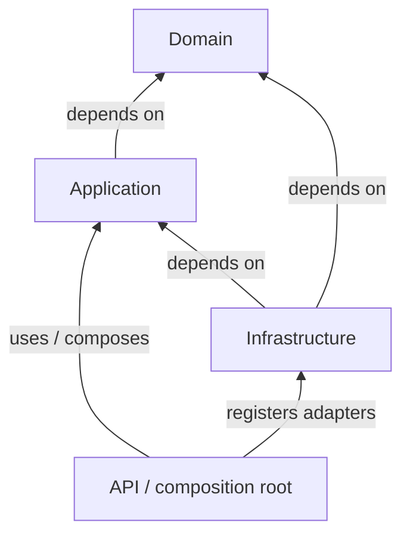
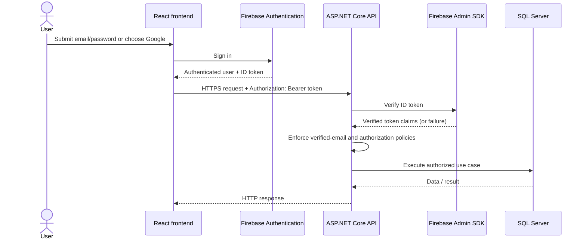

# AlgoTrack — System Architecture

**Status:** Initial architecture proposal for MVP review  
**Issue:** #1 — Finalize AlgoTrack system architecture documentation

Related context: [System Context](./system-context.md)

## 1. Architecture goals

The architecture should help AlgoTrack demonstrate practical software-engineering skills while remaining small enough for a solo portfolio project.

Primary goals:

- Separate business rules from HTTP, Firebase, EF Core, and SQL Server details.
- Make authentication and resource ownership enforcement explicit.
- Keep use cases testable without requiring a live database or Firebase for every unit test.
- Use CQRS where it clarifies read and write workflows, without introducing unnecessary messaging infrastructure.
- Keep the MVP deployable and understandable by one developer.

Non-goals for the MVP include microservices, event sourcing, distributed messaging, and a separate read database.

## 2. Logical component diagram



The diagram is a logical view. Exact project names, package choices, and endpoint organization should be settled when creating the .NET solution.

## 3. Proposed solution structure

A pragmatic Clean Architecture solution could use the following projects:

```text
src/
  AlgoTrack.Domain/
    Common/
    Topics/
    Roadmaps/
    Problems/
    Practice/
    Reviews/

  AlgoTrack.Application/
    Abstractions/
    Common/
    Topics/
    Roadmaps/
    Problems/
    Practice/
    Reviews/

  AlgoTrack.Infrastructure/
    Persistence/
    Authentication/
    Authorization/
    Seeding/

  AlgoTrack.Api/
    Controllers/
    Middleware/
    Configuration/

tests/
  AlgoTrack.Domain.Tests/
  AlgoTrack.Application.Tests/
  AlgoTrack.Api.IntegrationTests/

frontend/
  # React + TypeScript + Tailwind CSS app
```

This is a proposed layout, not a requirement to create every folder immediately. Create folders when a real use case needs them. The frontend may live in a separate repository later if deployment or team boundaries justify it; for the portfolio MVP, a monorepo keeps setup and review straightforward.

## 4. Clean Architecture dependency rules

The key rule is that source-code dependencies point inward toward policy, not outward toward infrastructure.

- **Domain** contains core entities and business invariants. It must not depend on ASP.NET Core, Firebase SDKs, EF Core, or SQL Server.
- **Application** coordinates use cases and defines interfaces it needs, such as repositories, current-user access, and unit-of-work abstractions where justified. It depends on Domain.
- **Infrastructure** implements persistence and external-service adapters. It depends on Application abstractions and Domain.
- **API** is the delivery boundary: HTTP endpoints, authentication configuration, dependency injection composition, and HTTP-specific concerns. It references Application and Infrastructure for composition.
- **Frontend** calls the public API and uses Firebase client SDK for sign-in. It is not part of the backend dependency graph.



Avoid putting business decisions inside controllers, EF Core configurations, or React components. Some simple input validation belongs at the API boundary, but domain invariants must still be protected server-side.

## 5. CQRS approach

Use a lightweight CQRS style inside the Application layer:

- **Queries** retrieve data and should not change application state.
- **Commands** request state changes and enforce the applicable business rules.
- Separate command and query handlers can be plain classes. A mediator library is optional, not a prerequisite.
- Both sides may use the same SQL Server database and EF Core model for the MVP.
- Do not add event sourcing, message queues, separate read models, or a second database without a demonstrated need.

Example use cases:

| Use case | Type | Main responsibility |
| --- | --- | --- |
| `GetMyRoadmapsQuery` | Query | Return only roadmaps owned by the authenticated user |
| `GetRoadmapDetailsQuery` | Query | Return roadmap content and the user's roadmap-topic progress after ownership checks |
| `CreateRoadmapCommand` | Command | Create a private roadmap for the authenticated user |
| `AddTopicToRoadmapCommand` | Command | Link a shared topic to a user's roadmap, enforcing uniqueness and archival rules |
| `MarkProblemSolvedCommand` | Command | Record solved status and update the user-problem review schedule |
| `ArchiveRoadmapTopicCommand` | Command | Archive the link without deleting the shared topic |
| `SoftDeleteProblemCommand` | Admin command | Soft-delete a problem after server-side admin authorization |
| `RestoreProblemCommand` | Admin command | Restore a soft-deleted problem after server-side admin authorization |

These are illustrative use-case names; the final API contracts may choose different names.

## 6. Firebase authentication and authorization

### Sequence diagram



### Required behavior

1. The frontend uses Firebase Authentication for the configured email/password and Google providers.
2. The frontend obtains a Firebase ID token and sends it in the Bearer authorization header for protected API calls.
3. ASP.NET Core validates the token on the server with the Firebase Admin SDK. It must validate the token's authenticity and relevant claims; it must not trust a decoded-but-unverified JWT.
4. The backend derives the authenticated Firebase UID from the verified principal. It does not accept a client-supplied UID as the identity of the caller.
5. The email-verification requirement is enforced on the server for protected application operations. The precise policy for sign-in, verification prompts, and allowed public endpoints must be documented in API contracts.
6. Authorization is checked per use case/resource. A valid token does not grant access to another user's private roadmap or review schedule.
7. Admin provisioning is server-configured. Do not allow the frontend or ordinary users to grant themselves admin status.
8. Return consistent `401 Unauthorized` responses for missing/invalid authentication and `403 Forbidden` responses when the caller is authenticated but lacks permission, subject to the API's documented error contract.

Official reference: [Verify Firebase ID tokens](https://firebase.google.com/docs/auth/admin/verify-id-tokens).

## 7. Data ownership and important business boundaries

- **Shared topic catalog:** topics are shared application data. Topic deletion is modeled as archival rather than destructive removal.
- **Private roadmaps:** each roadmap has an owner. Every read or write must verify ownership server-side.
- **Roadmap-topic relationship:** progress belongs to the user's roadmap-topic link, not to the shared topic globally. Removing a topic from a roadmap archives the link, preserving history.
- **Problem catalog:** problem management is restricted to the seed/admin workflow. Ordinary learners cannot create or edit catalog problems.
- **Problem deletion:** use soft deletion so historical practice and review records can remain consistent. Restoration reverses the deleted state according to the approved rules.
- **Practice status:** the current product decision uses `Solved` as the practice status. The API should validate status transitions and required fields.
- **Review schedules:** schedules are scoped to a user-problem pair. A uniqueness rule should prevent duplicate active schedules for the same pair.
- **Review policy:** the policy is fixed for the MVP. The exact intervals must be documented in the business rules before implementing the scheduler.

These rules must be reflected in database constraints where practical and enforced in application logic where database constraints alone are insufficient.

## 8. Security boundaries

### Authentication

- Verify Firebase ID tokens on the API server.
- Require HTTPS outside local development.
- Never put Firebase Admin credentials, SQL Server passwords, or privileged secrets in frontend variables.
- Do not log raw ID tokens or credentials.

### Authorization

- Use the verified principal as the source of the caller's identity.
- Check resource ownership in the Application/use-case path, not only by hiding buttons in the UI.
- Protect admin operations with server-side configuration/policies.
- Apply the verified-email policy on the server.
- Avoid returning whether a private resource exists to unauthorized callers if that would disclose sensitive information; document the chosen `403` versus `404` behavior.

### CORS

- Configure explicit allowed origins per environment.
- Allow only the required methods and headers, including `Authorization` and `Content-Type` where needed.
- Handle preflight `OPTIONS` requests through the ASP.NET Core CORS middleware configuration.
- CORS is not a substitute for authentication or authorization. Non-browser clients can call the API regardless of browser CORS restrictions.

## 9. Error handling and observability

- Use centralized exception handling to map known application errors to consistent HTTP responses.
- Do not expose stack traces, connection strings, tokens, or internal exception details to clients.
- Log diagnostic context with a correlation/trace identifier while excluding secrets and unnecessary personal data.
- Distinguish validation errors, authentication failures, authorization failures, not-found results, and unexpected server errors.
- Add health checks and structured logging when the API foundation is created; avoid building a complex observability stack for the initial MVP.

## 10. Testing strategy

| Test level | Focus | External dependencies |
| --- | --- | --- |
| Domain unit tests | Invariants, archival, soft deletion/restoration, review rules | None |
| Application unit tests | Command/query behavior, ownership checks, validation | Fakes or test doubles for abstractions |
| API integration tests | Routing, serialization, status codes, authentication/authorization pipeline | Test host; controlled test persistence where practical |
| Database tests | EF Core mappings, constraints, migrations, transaction behavior | Dedicated test SQL Server/database |
| Frontend tests | Loading/error states, forms, route guards, API integration behavior | Mocked API/Firebase where appropriate |

Tests must include negative security cases, not only successful requests: missing token, invalid token, unverified email, non-owner access, and non-admin access to admin endpoints.

## 11. Design trade-offs

| Decision | Benefit | Cost / limitation | MVP rationale |
| --- | --- | --- | --- |
| Modular monolith instead of microservices | Simple deployment and debugging; easy to understand | Less independent scaling by module | One developer and modest MVP scope |
| SQL Server as the single application database | Relational integrity and mature tooling | Requires schema/migration discipline | Data is relational and ownership constraints matter |
| Firebase Authentication | Delegates password handling and social sign-in | Adds an external dependency and provider-specific identity flow | Email/password and Google are required |
| Clean Architecture layers | Isolates business rules and supports unit testing | More projects and mapping/boilerplate | Useful learning and portfolio objective; keep layers pragmatic |
| Lightweight CQRS | Makes reads and state changes explicit | More handlers and DTOs | Helps explain use cases without requiring distributed CQRS |
| Shared topic/problem catalog | Avoids per-user duplication | Catalog changes can affect many users; archival rules are important | Matches shared-topic and seed/admin decisions |
| Private roadmaps | Clear ownership and privacy boundary | Requires consistent ownership checks | Matches roadmap ownership decision |
| Soft deletion and archival | Preserves history and supports restoration | Queries must consistently filter archived/deleted records | Matches product decisions |
| Fixed review policy | Predictable and easy to test | Less adaptive than spaced-repetition algorithms | Matches simple fixed-policy MVP decision |

## 12. Assumptions and open decisions

### Assumptions for the first implementation

- The app is a single deployable ASP.NET Core API and a React frontend.
- SQL Server is the system of record for AlgoTrack application data; Firebase stores identity-provider data.
- The API is stateless with respect to sign-in sessions and verifies a Firebase ID token on protected requests.
- The initial application is a portfolio project, not a high-availability production service.
- CI will run builds and tests before merge once workflows are configured.

### Decisions still to confirm

- Exact .NET target framework and package versions.
- Final deployment providers and environment strategy.
- Exact allowed CORS origins for local, staging, and production.
- Exact fixed review intervals and behavior when a due review is skipped.
- Exact response policy for inaccessible private resources (`403` or `404`).
- Whether integration tests will use a dedicated SQL Server instance or a container.
- How server-configured admin identities are represented and rotated without committing secrets.

Record changes to approved product/database decisions in the decision log before changing the implementation.

## 13. References

- [Firebase Authentication](https://firebase.google.com/docs/auth)
- [Verify Firebase ID tokens](https://firebase.google.com/docs/auth/admin/verify-id-tokens)
- [ASP.NET Core CORS](https://learn.microsoft.com/en-us/aspnet/core/security/cors)
- [GitHub: Creating diagrams](https://docs.github.com/en/get-started/writing-on-github/working-with-advanced-formatting/creating-diagrams)
