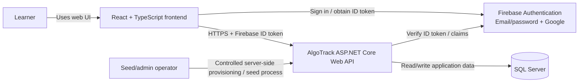

# AlgoTrack — System Context

**Status:** Initial architecture proposal for MVP review  
**Issue:** #1 — Finalize AlgoTrack system architecture documentation

## 1. Purpose

AlgoTrack is a portfolio-oriented web application for organizing algorithm and data-structure practice. Users can create private roadmaps from a shared topic catalog, track progress, record solved problems, and manage review schedules.

This document defines the system boundary and the external actors/services that interact with AlgoTrack. It is a design artifact, not a claim that the system has already been implemented.

## 2. System context diagram

The diagram is a logical context view. The API verifies Firebase ID tokens using the Firebase Admin SDK and its server-side verification capabilities; it does not trust a user ID supplied by the browser. Verification should use the supported Firebase server SDK rather than a client-provided claim. See [Firebase: Verify ID tokens](https://firebase.google.com/docs/auth/admin/verify-id-tokens).

## 3. Actors and responsibilities

| Actor / system | Responsibility | Trust boundary |
| --- | --- | --- |
| Learner | Signs in, manages private roadmaps, records practice, and reviews due problems | Untrusted client |
| Seed/admin operator | Maintains the seeded problem catalog and authorized administrative configuration | Privileged operational access |
| React frontend | Presents UI, calls Firebase Auth, sends API requests with an ID token | Public client; never a trusted authorization authority |
| Firebase Authentication | Authenticates users through configured email/password and Google providers | External identity provider |
| ASP.NET Core API | Verifies identity, enforces authorization and business rules, and exposes API contracts | Trusted application boundary after authentication and authorization |
| SQL Server | Persists AlgoTrack application data and enforces relational constraints | Private data store; should not be directly accessible from the browser |

## 4. Key system rules

- Firebase Authentication establishes the user's identity. The backend must verify the Firebase ID token on protected requests.
- The backend must reject requests with missing, invalid, expired, or otherwise unacceptable tokens.
- Email verification is required by the product decision. The backend must enforce this policy for protected application operations, not rely only on the frontend hiding UI.
- Authentication is not authorization. A valid user may access only their own private roadmaps and associated user-specific data.
- Admin privileges must be provisioned and checked server-side. A client-supplied `isAdmin` flag or user ID is never sufficient.
- Shared topics and the problem catalog are application-managed data. Problems are managed through the approved seed/admin process, not by ordinary learners.
- SQL Server credentials and Firebase Admin credentials must never be shipped to the browser or committed to the repository.

## 5. Main request flows

### Sign-in and API access

1. The user signs in through Firebase Authentication using email/password or Google.
2. Firebase returns a Firebase ID token to the frontend.
3. The frontend sends the token as `Authorization: Bearer <Firebase-ID-token>` when calling a protected API.
4. ASP.NET Core authentication middleware validates the token using the server-side Firebase Admin SDK.
5. Application authorization checks verified-email policy, resource ownership, and any required administrative permission.
6. The API executes the use case and reads or writes SQL Server data.
7. The API returns a response using the documented API contract.

### Practice and review

1. The learner opens a problem from the shared catalog.
2. The learner records the problem as `Solved`.
3. The API validates the request and verifies access to the relevant user-owned roadmap or practice record.
4. The API persists the practice state and creates or updates the review schedule according to the fixed review policy.
5. The learner can view due reviews for their own user-problem schedule.

The exact review intervals and endpoint shapes belong in the approved business rules and API contracts. They should not be guessed in this context document.

## 6. Deployment boundary (MVP proposal)

For the MVP, the simplest reasonable deployment shape is:

- Static React frontend served over HTTPS.
- ASP.NET Core Web API served over HTTPS.
- Firebase Authentication as the external identity provider.
- SQL Server accessible only to the API and authorized operational tooling.

The frontend and API may be hosted on different origins. If so, the API must configure CORS for the explicit frontend origin(s), methods, and headers needed by the application. CORS is a browser access policy, not authentication or authorization.

## 7. Out of scope for this diagram

- Cloud provider or hosting vendor selection.
- High-availability topology, load balancing, and disaster-recovery design.
- Detailed database table definitions.
- Detailed endpoint request/response schemas.
- CI/CD implementation.

## 8. Open questions to resolve before implementation

- Which hosting platforms and environments will be used for frontend, API, and SQL Server?
- Will development use a local SQL Server instance, Docker, or a shared development database?
- Which exact origins are allowed for local development, staging, and production?
- What is the operational process for running problem seeds and configuring admin identities?
- What should the UX do when a user is signed in but has not verified their email?

## 9. References

- [Firebase Authentication](https://firebase.google.com/docs/auth)
- [Verify Firebase ID tokens](https://firebase.google.com/docs/auth/admin/verify-id-tokens)
- [GitHub: Creating diagrams](https://docs.github.com/en/get-started/writing-on-github/working-with-advanced-formatting/creating-diagrams)
