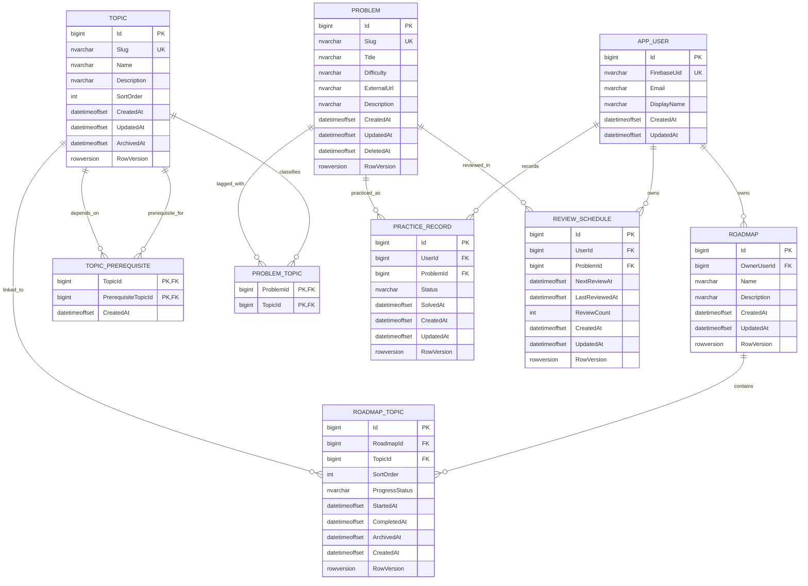

# AlgoTrack — Physical Database Design

**Status:** Updated design reflecting approved decisions; remaining items are listed as open questions
**Database:** Microsoft SQL Server  
**ORM:** Entity Framework Core (planned)

> This is a documentation proposal, not an implemented schema or migration. Resolve the open questions before calling it final.

## 1. Approved decisions reflected

- Topics are shared.
- Problems are managed through seed/admin processes.
- Practice status is `Solved`; store only the current state per user-problem pair, with no attempt-history table.
- Review policy is simple and fixed.
- Roadmaps are private and user-owned.
- Roadmap deletion is archive-only in the MVP; do not physically delete roadmaps.
- Topic progress belongs to `RoadmapTopic`, with approved values `NotStarted`, `InProgress`, and `Completed`.
- Review schedule scope is one user-problem pair; create the schedule only when the problem becomes `Solved`.
- Removing a topic from a roadmap archives the link.
- Topics are archived rather than deleted.
- Problems are soft-deleted and can be restored.
- Admin access is provisioned server-side.
- Email verification is required for protected application operations.

## 2. Proposed physical ERD

## 3. Table responsibilities and business rules

### `AppUser`
Application profile linked to Firebase. `FirebaseUid` is unique and comes only from a verified ID token. Do not store passwords or Firebase Admin credentials here. Email/display name are profile snapshots, not proof of identity or verification.

### `Roadmap`
Private roadmap owned by one user. All reads and writes must be scoped to the authenticated owner. `RowVersion` is an optional SQL Server optimistic-concurrency token.

### `Topic`
Shared topic catalog with a stable unique `Slug`. `ArchivedAt IS NULL` means active. Archiving should block new links while preserving historical relationships, subject to the final product rule.

### `RoadmapTopic`
Connects a private roadmap to a shared topic. Progress belongs here, not on `Topic`. Archive the relationship by setting `ArchivedAt`; do not delete the shared topic. Proposed unique constraint: `(RoadmapId, TopicId)` across active and archived rows. Re-adding should restore the existing row instead of inserting a duplicate. The approved progress values are `NotStarted`, `InProgress`, and `Completed`.

### `TopicPrerequisite`
Directed edge between two topics, with composite PK `(TopicId, PrerequisiteTopicId)`. Add a check constraint against self-dependency. Application validation must detect cycles because a simple SQL check constraint cannot prevent arbitrary graph cycles. Topic archival is preferred to hard deletion.

### `Problem`
Shared catalog maintained through seed/admin workflows. `Slug` is unique and stable for idempotent seeding. `DeletedAt IS NULL` means active. Soft-delete sets `DeletedAt`; restore clears it. Keep historical practice/review rows. Admin privileges must be server-configured, not client-controlled.

### `ProblemTopic`
Many-to-many relationship between problems and topics, with composite PK `(ProblemId, TopicId)`. Prefer preserving associations when a problem is soft-deleted or a topic archived.

### `PracticeRecord`
Proposed as the user's current state for a problem, unique on `(UserId, ProblemId)`. The MVP status is constrained to `Solved`, with `SolvedAt` recording when it was marked solved. The MVP stores only the current state per user-problem pair. Do not add a `PracticeAttempt` table for the MVP.

### `ReviewSchedule`
One schedule per `(UserId, ProblemId)`, enforced by a unique constraint. `NextReviewAt` and `LastReviewedAt` use UTC-normalized `datetimeoffset`; `ReviewCount` must be non-negative. Fixed intervals must be defined in business rules before implementation.

## 4. Constraints and indexes

| Table | Constraint / index | Reason |
| --- | --- | --- |
| `AppUser` | Unique `FirebaseUid` | One profile per Firebase identity |
| `Roadmap` | Index `(OwnerUserId, CreatedAt)` | Owner-scoped roadmap listing |
| `RoadmapTopic` | Unique `(RoadmapId, TopicId)` | Prevent duplicate links, including archived ones |
| `RoadmapTopic` | Index `(RoadmapId, ArchivedAt, SortOrder)` | Load active topics in order |
| `Topic` | Unique `Slug` | Stable topic identity |
| `TopicPrerequisite` | Composite PK | Prevent duplicate prerequisite edges |
| `Problem` | Unique `Slug` | Idempotent seed identity |
| `Problem` | Index `(DeletedAt, Difficulty)` | Filter active problems by difficulty |
| `ProblemTopic` | Composite PK | Prevent duplicate topic tags |
| `PracticeRecord` | Unique `(UserId, ProblemId)` | One current state per user/problem |
| `ReviewSchedule` | Unique `(UserId, ProblemId)` | One schedule per user/problem |
| `ReviewSchedule` | Index `(UserId, NextReviewAt)` | Efficient due-review lookup |

Review indexes against actual query patterns before implementation. Avoid indexes without a use-case rationale.

## 5. Deletion and restoration rules

| Operation | Proposed behavior |
| --- | --- |
| Remove topic from roadmap | Archive the `RoadmapTopic` link by setting `ArchivedAt`; retain progress/state |
| Archive topic | Set `Topic.ArchivedAt`; preserve historical relationships |
| Soft-delete problem | Set `Problem.DeletedAt`; retain practice/review records |
| Restore problem | Clear `Problem.DeletedAt`; retain practice/review records |
| Delete prerequisite edge | Delete only the edge, never either topic |
| Delete roadmap | Archive the roadmap; do not physically delete it in the MVP |
| Delete user/account | Retention and account-deletion policy not yet decided |

Use `Restrict`/`NoAction` for catalog relationships where accidental cascades could erase history. Use cascade deletion only for dependent records whose lifecycle is explicitly approved.

## 6. Authentication and authorization

- Verify Firebase ID tokens on the server.
- Map the verified Firebase UID to `AppUser.FirebaseUid`.
- Derive user identity from the authenticated principal, never a request-body `UserId` or `OwnerUserId`.
- Check roadmap ownership for every protected read/write.
- Enforce verified-email policy server-side.
- Protect catalog administration with server-configured authorization.
- Database constraints do not replace authorization checks.

## 7. Migration and seed strategy

- Use EF Core migrations for schema changes.
- Use stable slugs for repeatable topic/problem seeding.
- Seed operations must be idempotent and must not duplicate records on rerun.
- Do not seed real user accounts or secrets.
- Decide how seed updates interact with manually archived topics or soft-deleted problems before implementing the seed process.

## 8. Open questions to resolve before final approval

1. **Archived topic behavior:** Can an existing roadmap-topic link still have its progress edited after the shared topic is archived?
2. **Fixed review intervals:** What exact intervals apply after solving and after each completed review? What are the rules for early, overdue, and repeated completion?
3. **Problem-topic associations:** Can associations change after users have practice state? Do associations need archival/audit behavior?
4. **Account deletion:** Is Firebase account deletion and data-retention behavior in MVP scope?
5. **Environment:** Which SQL Server version and local development setup will be used?
6. **Seed reconciliation:** How should seed updates behave when an administrator has manually edited or soft-deleted a seeded problem?

Do not silently guess answers. Resolve them in this issue or the decision log before generating migrations.

## 9. Definition of Done

- [ ] ERD matches approved product/database decisions.
- [ ] Tables, SQL types, nullability, PKs, FKs, and unique constraints are documented.
- [ ] Archive, soft-delete, restore, and referential-action behavior is explicit.
- [ ] Ownership and admin authorization boundaries are documented.
- [ ] Indexes have a query/use-case rationale.
- [ ] Open questions are resolved or explicitly accepted as deferred.
- [ ] No EF Core entities or migrations are included in this documentation-only change.
